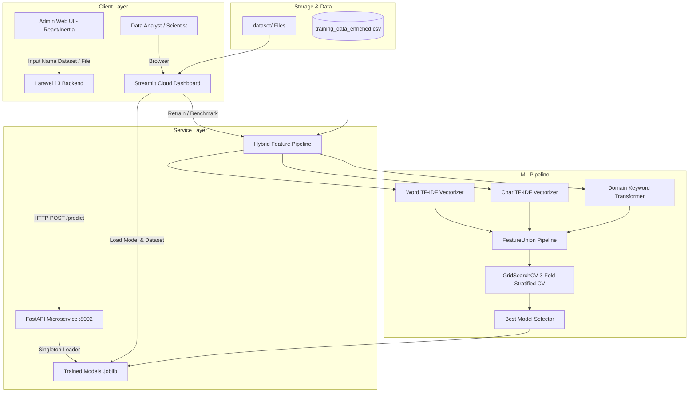

# 🏷️ OpenData ML Classifier — Automated Dataset Tagging System

<div align="center">

[](https://opendata-ml-classifier-8vryjxsngcksc7udfnnliw.streamlit.app/)
[](https://www.python.org/)
[](https://scikit-learn.org/)
[](https://fastapi.tiangolo.com/)
[](https://streamlit.io/)
[](https://www.docker.com/)
[](LICENSE)

**End-to-End Machine Learning System untuk Klasifikasi Multi-Label Otomatis Dataset Pemerintah Terbuka (Open Data)**

[🌐 Buka Live Dashboard di Streamlit Cloud](https://opendata-ml-classifier-8vryjxsngcksc7udfnnliw.streamlit.app/) • [📖 Dokumentasi API](#-dokumentasi-fastapi-microservice) • [🚀 Panduan Memulai](#-instalasi--menjalankan-lokal)

</div>

---

## 📌 Daftar Isi
1. [Latar Belakang & Masalah](#-latar-belakang--masalah)
2. [Solusi & Fitur Unggulan](#-solusi--fitur-unggulan)
3. [Arsitektur Sistem](#-arsitektur-sistem)
4. [Pipeline Machine Learning & NLP](#-pipeline-machine-learning--nlp)
5. [Hasil Benchmark & Evaluasi Model](#-hasil-benchmark--evaluasi-model)
6. [Komponen Aplikasi](#-komponen-aplikasi)
   - [A. Streamlit Dashboard (MLOps & Analytics)](#a-streamlit-dashboard-mlops--analytics)
   - [B. FastAPI Microservice (High-Performance Inference)](#b-fastapi-microservice-high-performance-inference)
7. [Integrasi Portal Open Data (Production Use-Case)](#-integrasi-portal-open-data-production-use-case)
8. [Struktur Repositori](#-struktur-repositori)
9. [Instalasi & Menjalankan Lokal](#-instalasi--menjalankan-lokal)
10. [Menjalankan dengan Docker](#-menjalankan-dengan-docker)
11. [Konfigurasi Environment Variables](#-konfigurasi-environment-variables)
12. [Lisensi & Kontribusi](#-lisensi--kontribusi)

---

## 📖 Latar Belakang & Masalah

Pada pengelolaan portal Satu Data / Open Data pemerintah skala nasional (*misalnya Portal Data Kementerian Komunikasi dan Digital — Komdigi*), ribuan dataset publik diunggah oleh berbagai satuan kerja dan unit Eselon. Setiap kali dataset diinput ke katalog, administrator wajib menentukan metadata kategorisasi:
1. **Thematic Group** (misal: *telekomunikasi, frekuensi-radio, pos-dan-informatika, aplikasi-informatika, penyiaran, dll.*)
2. **Organization / Unit Produsen Data** (misal: *SDPPI, DJPPI, APTIKA, IKP, Balitbang, Setjen, Itjen, dll.*)

### Tantangan yang Dihadapi:
* **Human Error & Inkonsistensi:** Judul atau nama file dataset sering kali ambigu, mengandung singkatan teknis (`smfr`, `bts`, `lhu`, `iar`), atau menggunakan format penamaan yang bervariasi antar unit.
* **Proses Manual Lambat:** Pengisian katalog memakan waktu karena admin harus memilih hierarki organisasi dan grup secara manual dari puluhan opsi dropdown.
* **Ceiling Akurasi NLP Konvensional:** TF-IDF berbasis kata murni (*word-level*) sering gagal menangkap pola pada teks yang sangat pendek atau nama file bertipe kode numerik.

---

## 💡 Solusi & Fitur Unggulan

**OpenData ML Classifier** dibangun sebagai solusi terpadu *end-to-end* yang menggabungkan rekayasa fitur NLP mutakhir, *ensemble model benchmarking*, *microservice inference*, dan *interactive analytics*:

* **⚡ Dual-Target Multi-Output Classification:** Memprediksi label **`group`** dan **`organization`** secara simultan dalam satu inferensi.
* **🧠 Hybrid NLP Feature Extraction:** Menggabungkan Word TF-IDF, Character-level TF-IDF (3–5 gram), dan **Domain Keyword Transformer** khusus sektor pemerintahan digital.
* **🎯 Top-K Recommendations with Confidence Scores:** Memberikan rekomendasi peringkat 1 sampai 3 disertai probabilitas keyakinan (0–100%) yang dinormalisasi.
* **🚀 Production-Ready FastAPI REST API:** Endpoint inferensi sub-milidetik berdesain *Singleton Pattern* untuk model loading.
* **📊 Interactive Streamlit Dashboard:** UI berbasis web untuk pemantauan data, benchmarking model real-time, pengujian interaktif, dan upload file baru.
* **🛡️ Zero-Downtime Fallback Architecture:** Terintegrasi dengan mekanisme *graceful degradation* (fallback ke pencarian fuzzy database jika service offline).

---

## 🏗️ Arsitektur Sistem



---

## 🔬 Pipeline Machine Learning & NLP

### 1. Rekayasa Fitur Hybrid (*Feature Engineering*)
Teks input diekstraksi dari kombinasi `filename`, `title`, `name`, dan `notes` melalui 3 kanal paralel:
* **Word TF-IDF (`ngram_range=(1, 2)`):** Menangkap frasa dan istilah leksikal lengkap.
* **Character n-gram TF-IDF (`ngram_range=(3, 5)`):** Menangani *typo*, variasi imbuhan bahasa Indonesia, dan singkatan teknis file (`frek`, `telko`, `sdm`, `bpptik`).
* **Domain Keyword Transformer (`Custom BaseEstimator`):** Menganalisis keberadaan kata kunci domain spesifik (*domain-specific dictionaries*) seperti:
  * *SDPPI:* `frekuensi`, `spektrum`, `radio`, `kalibrasi`, `smfr`, `satelit`, `ikrap`, `lhu`
  * *DJPPI:* `penyiaran`, `pos`, `seluler`, `bandwidth`, `teledensitas`, `enodeb`, `isp`
  * *APTIKA:* `domain`, `pse`, `siber`, `insiden`, `e-commerce`, `aplikasi`

### 2. Strategi Pelatihan & Tuning
* **Cross-Validation:** 3-fold *Stratified K-Fold* untuk memastikan distribusi kelas minoritas tetap proporsional.
* **Optimasi Metric:** Menggunakan **`f1_weighted`** untuk mengatasi ketimpangan frekuensi dataset antar-organisasi (*imbalanced classes*).
* **GridSearchCV:** Eksplorasi hiperparameter intensif untuk parameter regularisasi ($C$, $\alpha$), kedalaman pohon (*max_depth*), dan jumlah estimator (*n_estimators*).

---

## 📊 Hasil Benchmark & Evaluasi Model

Evaluasi dilakukan pada 10 algoritma klasifikasi machine learning:

### 1. Klasifikasi Label Thematic `group` (10 Kelas)
| Algoritma | Train Accuracy | Train F1-Score | CV F1-Score (3-Fold) | Status |
|---|:---:|:---:|:---:|:---:|
| **Ridge Classifier** | **1.0000** | **1.0000** | **0.9400** | 🏆 **Best Model** |
| **Complement Naive Bayes** | 1.0000 | 1.0000 | 0.9323 | High Performer |
| **Linear SVC** | 1.0000 | 1.0000 | 0.9306 | High Performer |
| **Logistic Regression** | 1.0000 | 1.0000 | 0.9166 | High Performer |
| **Extra Trees Classifier** | 1.0000 | 1.0000 | 0.8123 | Competitive |
| **Random Forest** | 1.0000 | 1.0000 | 0.7086 | Baseline |

### 2. Klasifikasi Label `organization` (12+ Kelas)
| Algoritma | Train Accuracy | Train F1-Score | CV F1-Score (3-Fold) | Status |
|---|:---:|:---:|:---:|:---:|
| **Linear SVC** | **0.9471** | **0.9480** | **0.7553** | 🏆 **Best Model** |
| **Logistic Regression** | 0.9059 | 0.9084 | 0.7443 | Runner Up |
| **Extra Trees** | 0.8882 | 0.8956 | 0.6871 | Competitive |
| **Random Forest** | 1.0000 | 1.0000 | 0.6560 | Baseline |

> Model serialisasi `.joblib` disimpan di direktori `ml_app/models/` lengkap dengan metadata `model_comparison.json`.

---

## 🖥️ Komponen Aplikasi

### A. Streamlit Dashboard (MLOps & Analytics)
Aplikasi Streamlit dirancang dengan antarmuka modern *dark-mode glassmorphism* (Google Fonts Inter, Plotly Analytics):

1. **🏠 Overview:**
   * Kartu ringkasan metrik total sampel, jumlah berkas, dan keunikan label.
   * Grafik batang interaktif distribusi grup dan diagram donat proporsi organisasi.
   * Tabel preview dataset yang dapat difilter.
2. **⚙️ Training & Model Comparison:**
   * Tombol *one-click* training seluruh model via GridSearchCV.
   * Tabel komparasi akurasi, F1-score, dan hiperparameter terbaik.
   * Seleksi otomatis model dengan performa tertinggi untuk produksi.
3. **🏷️ Auto-Tag Dataset:**
   * Fitur pemindaian berkas di direktori dataset.
   * Inferensi batch dan per-file dengan koreksi label manual oleh analis.
   * Ekspor hasil prediksi langsung ke `classification_results.csv`.
4. **📤 Upload & Classify:**
   * Drag-and-drop file baru (`.csv`, `.xlsx`, `.pdf`, `.docx`).
   * Visualisasi Top-3 rekomendasi beserta indikator probabilitas dinamis.
   * Opsi simpan langsung ke *training dataset* untuk *continual learning*.

🌐 **Akses langsung:** [https://opendata-ml-classifier-8vryjxsngcksc7udfnnliw.streamlit.app/](https://opendata-ml-classifier-8vryjxsngcksc7udfnnliw.streamlit.app/)

---

### B. FastAPI Microservice (High-Performance Inference)
Microservice backend di direktori `ml_service/` melayani prediksi cepat untuk sistem lain:

* **Pola Desain Singleton:** Model dimuat ke memori saat startup aplikasi (`@asynccontextmanager`), menghindari latensi pemuatan file ulang pada setiap HTTP request.
* **Validasi Pydantic:** Pengetatan tipe data, batasan panjang string, dan nilai fallback yang aman.

#### Endpoints:
* `GET /health` — Cek ketersediaan server dan status pemuatan model `.joblib`.
* `POST /predict` — Prediksi label `group` & `organization` (top-K kandidat + confidence score).
* `GET /docs` — Swagger UI interaktif untuk testing langsung di browser.

---

## 🔗 Integrasi Portal Open Data (Production Use-Case)

Sistem ini terintegrasi penuh ke dalam Portal Resmi Open Data (`data.komdigi.go.id`):
1. **Debounced Live Recommendation (React / Inertia.js):**
   * Saat admin mengetikkan judul dataset di form pembuatan katalog, sistem menerapkan *debounce* 800ms sebelum memanggil endpoint rekomendasi.
2. **Confidence Score Dynamic Badging:**
   * Probabilitas $\ge 80\%$: Badge Hijau (Rekomendasi Tinggi)
   * Probabilitas $50\% - 79\%$: Badge Kuning (Rekomendasi Sedang)
   * Probabilitas $< 50\%$: Badge Abu-abu (Perlu Verifikasi)
3. **Graceful Fallback:**
   * Jika ML microservice mengalami kendala jaringan atau *timeout* (3 detik), sistem otomatis beralih ke pencarian *fuzzy keyword* pada basis data SQL lokal tanpa memutus alur pengguna (*zero downtime*).

---

## 📁 Struktur Repositori

```text
opendata-ml-classifier/
├── ml_app/                          # Modul Streamlit UI & ML Pipeline
│   ├── app.py                       # Main script Streamlit Dashboard
│   ├── feature_extractor.py         # TF-IDF, tokenizer, & DomainKeywordTransformer
│   ├── trainer.py                   # GridSearchCV pipeline & model persistence
│   ├── classifier.py                # Engine inferensi & prediksi top-K
│   ├── requirements.txt             # Dependensi khusus Streamlit
│   └── models/                      # Artefak model terlatih (.joblib)
│       ├── best_group.joblib        # Model terbaik untuk label group
│       ├── best_organization.joblib # Model terbaik untuk label organization
│       ├── tfidf_vectorizer.joblib  # Vectorizer gabungan
│       └── model_comparison.json    # Riwayat skor & benchmark model
│
├── ml_service/                      # Modul FastAPI Microservice
│   ├── main.py                      # Router & lifecycle FastAPI
│   ├── model_loader.py              # Singleton loader & engine inferensi
│   ├── schemas.py                   # Pydantic schemas (PredictRequest, dll.)
│   └── requirements.txt             # Dependensi khusus FastAPI
│
├── dataset/                         # Folder sampel data uji
├── training_data_enriched.csv       # Basis data training berlabel
├── classification_results.csv       # Hasil klasifikasi otomatis
├── Dockerfile                       # Definisi container image Python 3.11-slim
├── docker-compose.yml               # Orkestrasi container Docker
├── requirements.txt                 # Dependensi root aplikasi
└── README.md                        # Dokumentasi teknis proyek
```

---

## ⚙️ Instalasi & Menjalankan Lokal

### Prasyarat
* Python $\ge$ 3.11
* Git

### 1. Klon Repositori
```bash
git clone https://github.com/fallss/opendata-ml-classifier.git
cd opendata-ml-classifier
```

### 2. Siapkan Virtual Environment
```bash
python -m venv venv

# Mengaktifkan di Linux/macOS:
source venv/bin/activate

# Mengaktifkan di Windows:
# venv\Scripts\activate
```

### 3. Pasang Dependensi
```bash
pip install -r requirements.txt
```

### 4. Menjalankan Dashboard Streamlit
```bash
streamlit run ml_app/app.py
```
Akses dashboard di browser Anda pada: `http://localhost:8501`

### 5. Menjalankan FastAPI Microservice
```bash
cd ml_service
uvicorn main:app --reload --host 0.0.0.0 --port 8002
```
Akses Swagger UI dokumentasi interaktif pada: `http://localhost:8002/docs`

---

## 📡 Dokumentasi FastAPI Microservice

### Contoh 1: Healthcheck (`GET /health`)
```bash
curl -X GET http://localhost:8002/health
```
**Response:**
```json
{
  "status": "ok",
  "models_loaded": true,
  "message": "ML Service berjalan normal."
}
```

### Contoh 2: Prediksi Dataset (`POST /predict`)
```bash
curl -X POST http://localhost:8002/predict \
  -H "Content-Type: application/json" \
  -d '{
    "filename": "data-frekuensi-radio-stasiun-bumi-2023.xlsx",
    "title": "Data Alokasi Spektrum Frekuensi Radio",
    "top_k": 3
  }'
```
**Response:**
```json
{
  "filename": "data-frekuensi-radio-stasiun-bumi-2023.xlsx",
  "pred_group": "frekuensi-radio",
  "pred_organization": "sdppi",
  "group_topk": [
    { "rank": 1, "label": "frekuensi-radio", "confidence": 91.4 },
    { "rank": 2, "label": "alat-dan-perangkat", "confidence": 5.2 },
    { "rank": 3, "label": "telekomunikasi", "confidence": 3.4 }
  ],
  "org_topk": [
    { "rank": 1, "label": "sdppi", "confidence": 94.8 },
    { "rank": 2, "label": "djppi", "confidence": 3.6 },
    { "rank": 3, "label": "djaplikasi", "confidence": 1.6 }
  ],
  "classified_at": "2026-10-11T13:00:00.000Z"
}
```

---

## 🐳 Menjalankan dengan Docker

Proyek ini telah dilengkapi konfigurasi Docker multi-stage yang ringan dan terisolasi:

```bash
# Build dan jalankan container di background
docker compose up -d --build

# Periksa status kontainer
docker compose ps

# Memeriksa log layanan
docker compose logs -f ml-service

# Mematikan kontainer
docker compose down
```

Layanan FastAPI akan langsung tersedia di `http://localhost:8002` lengkap dengan *healthcheck* otomatis setiap 30 detik.

---

## ⚙️ Konfigurasi Environment Variables

Buat file `.env` berdasarkan template `.env.example`:

| Variabel | Default | Deskripsi |
|---|:---:|---|
| `ML_SERVICE_HOST` | `0.0.0.0` | Host listener service Uvicorn |
| `ML_SERVICE_PORT` | `8002` | Port service FastAPI |
| `ML_CORS_ORIGINS` | `*` | Daftar origin yang diizinkan (pisahkan dengan koma) |
| `ML_SERVICE_URL` | `http://localhost:8002` | Endpoint URL yang dikonsumsi backend Laravel |

---

## 👨‍💻 Kontribusi & Pengembang

* **Pengembang:** Arya Javas Fatih ([@fallss](https://github.com/fallss))
* **Peran:** Machine Learning Engineer & Fullstack Data Analyst
* **Instansi:** Kementerian Komunikasi dan Digital Republik Indonesia (Komdigi)

Dilisensikan di bawah [MIT License](LICENSE).
