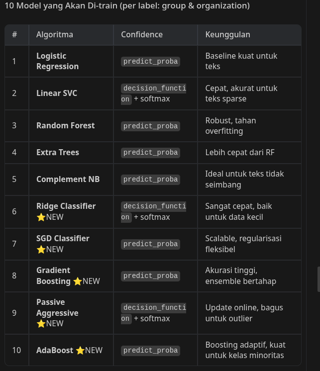

# ML Auto-Tagging Dashboard

Aplikasi Streamlit yang mengklasifikasi file-file di folder `dataset/` secara otomatis ke label `group` dan `organization` menggunakan 5 model ML dengan GridSearchCV + hyperparameter tuning, lengkap dengan dashboard perbandingan model dan file uploader.

---

## Proposed Changes

### Project Structure

```
dataAnalyst/
├── ml_app/
│   ├── app.py                  [NEW] Streamlit dashboard (entry point)
│   ├── feature_extractor.py    [NEW] Ekstraksi fitur dari nama file & CSV
│   ├── trainer.py              [NEW] Training 5 model + GridSearchCV
│   ├── classifier.py           [NEW] Prediksi label untuk file baru/existing
│   └── requirements_ml.txt     [NEW] Dependencies ML
├── dataset/                    (existing)
├── training_data.csv           (existing)
├── training_data_enriched.csv  (existing — sumber label training)
└── classification_results.csv  [NEW] Output hasil klasifikasi
```

---

### ml_app/requirements_ml.txt

```
streamlit, scikit-learn, pandas, numpy, joblib, tqdm, openpyxl
```

---

### ml_app/feature_extractor.py

Ekstraksi fitur berbasis teks dari nama file:
- Tokenisasi nama file (slug → kata-kata)
- TF-IDF vectorizer fit dari semua nama file + title di CSV
- Output: sparse matrix untuk training / prediksi

---

### ml_app/trainer.py

5 model yang dibandingkan via **GridSearchCV (5-fold CV)**:

| # | Model | Hyperparameter yang di-tuning |
|---|-------|-------------------------------|
| 1 | Logistic Regression | `C`, `max_iter` |
| 2 | Random Forest | `n_estimators`, `max_depth` |
| 3 | Linear SVC | `C`, `max_iter` |
| 4 | Gradient Boosting | `n_estimators`, `learning_rate`, `max_depth` |
| 5 | Multinomial Naive Bayes | `alpha` |

- Dua target label: **`group`** dan **`organization`**
- Model terbaik disimpan via `joblib`
- Hasil perbandingan disimpan ke `model_comparison.json`

---

### ml_app/classifier.py

- Load model terbaik dari joblib
- Prediksi `group` dan `organization` untuk file tertentu
- Append hasil ke `classification_results.csv`
- Append baris baru ke `training_data_enriched.csv` untuk file yang diupload

---

### ml_app/app.py (Streamlit Dashboard)

**4 halaman (sidebar navigation):**

1. **🏠 Overview** — statistik dataset, distribusi label
2. **⚙️ Training & Model Comparison** — tombol training, tabel perbandingan 5 model (accuracy, F1, best params), chart bar
3. **🏷️ Auto-Tag Dataset** — tabel semua file di `dataset/`, hasil prediksi group & org per file, tombol "Simpan ke CSV"
4. **📤 Upload & Classify** — drag-and-drop upload file baru, prediksi langsung, simpan ke `dataset/`, tambah ke training data

---

## Verification Plan

```bash
cd ~/dataAnalyst
pip install -r ml_app/requirements_ml.txt
streamlit run ml_app/app.py
```

Verifikasi:
1. Halaman Overview tampil statistik dataset
2. Klik "Mulai Training" → 5 model terlatih, tabel perbandingan muncul
3. Tab Auto-Tag → file di `dataset/` diklasifikasi
4. Tab Upload → upload file baru → file tersimpan di `dataset/`, baris baru di CSV

